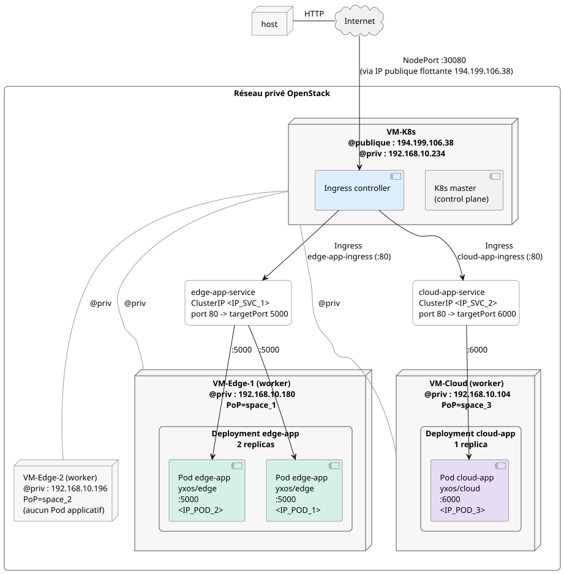

## Etape 1 :

### 1. Quel est le rôle de VM-K8s dans l’architecture mise en place ? Quelle est la différence entre cette machine et les nœuds workers ?
VM-K8s est le master du cluster, c'est lui qui dirige toutes les autres VM du cluster. Il gère les pods et surveille leur état, sans exécuter d'application.
Les noeuds workers contiennent des pods qui contiennent les applications conteneurisées.

### 2. Pourquoi avoir attribué les labels "PoP=space_x" aux workers ?
Afin de les placer dans différentes zones de la Smart City, comme de vraies antennes relais. Comme nous avons précisé les labels dans les deployment, les pods et donc les applications se créent forcément sur les VM assignées et pas alétoirement.  

### 3. Le script d’installation vous a permis d’installer Kubernetes sans exécuter manuellement toutes les commandes nécessaires. Citez les opérations importantes réalisées par le script master et expliquez très brièvement en quoi elles sont nécessaires au fonctionnement du cluster.
Le script configure les paramètres réseaux des VMs, installe Kubernetes, initialise le cluster dans Kubernetes, installe des fonctionnalités comme Calico pour la gestion du réseau et de la sécurité, Helm pour le déploiement d'applications et Traefik pour la répartition de la charge du réseau, et installe kubectl pour la gestion du cluster.

## Etape 2 :

### 1. Quel est le rôle d’un Deployment dans Kubernetes ? Pourquoi ne déploie-t-on pas directement un Pod ?
Un Deployment sert à indiquer à Kubernetes ce qu'il doit exécuter (image de conteneur, nombre de replicas...). Kubernetes vérifie aussi que l'état décrit dans le Deployment est respecté à tout instant, par exemple si un Pod s'arrête il en recréer un.  
On pourrait déployer directement un Pod mais il serait beaucoup moins supervisable (s'il s'arrête personne ne le relance).

### 2. Quelle est la différence entre "port" et "targetPort" dans un Service ?
Dans un service, le port désigne le service qui est joignable dans le cluster  (ici 80).  
Le targetPort est le port sur lequel les pods écoutent (ici 5000).  
Donc le Service reçoit le traffic sur le port 80 et le le redirige vers le targetPort (pour edge-app sur le port 5000).

### 3. Quelle est la différence entre une ressource Service et une ressource Ingress ? Quel problème chacune permet-elle de résoudre ?
Une ressource Service est un point d'accès entre l'application Edge et les Pods. Elle permet à l'application Edge de communiquer avec les Pods du cluster.    
Une ressource Ingress est un point d'accès entre l'application Edge et Internet. Elle permet à l'application Edge d'être accessible depuis l'extérieur.

### 4. Dans l’architecture actuelle, on trouve les ports 80, 5000 et 30080. Quel est le rôle de chacun ?
Le port 80 permet de contacter le Traefik qui s'occupe ensuite de redistribuer le traffic.  
Le port 5000 permet à Kubernetes de communiquer avec les Pods.  
Le NodePort 30080 permet une connexion entre Internet et la VM-K8s et donc Traefik. C'est le port ouvert sur internet.

## Etape 3 :

### Réalisez un diagramme de l’architecture complète mise en place jusqu’à présent. Faites apparaître :
### — les VM et leurs adresses IP
### — les Pods et leurs applications conteneurisées
### — les adresses IP et ports utilisés par les ressources Kubernetes.

